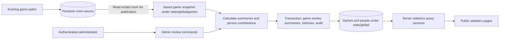

# Game statistics: technical specification

Status: Implemented in dependent draft PRs; see the delivery plan and operations runbook for production release gates.

Date: 2026-10-29  
Product source: `../../../product-feature-brief-game-statistics.md`  
Repository baseline: `main`, `cba089c`; `git pull --ff-only` reported up to date.  
Delivery plan: [Game statistics implementation plan](implementation-plan.md)

## 1. Scope and decisions

Build public game, player, and host statistics, with an administrator workflow for reviewing games, resolving identities, setting question maxima, and publishing completed games. Use the existing Next.js application, Firebase Authentication, Firestore, and Firebase Storage. The linked delivery plan tracks application implementation.

The feature brief defines product requirements. Repository observations below describe the current implementation. Recommendations and unresolved engineering details are explicitly identified.

### Decisions confirmed with the technical lead

| ID | Decision | Effect on the brief |
| --- | --- | --- |
| D1 | Store all feature data in Firestore. | Resolves storage choice. No PostgreSQL or second authentication framework. |
| D2 | Google sign-in at `/login`, protected admin grant/revoke UI, and a one-time first-admin bootstrap script. | Resolves provider and role-management questions. |
| D3 | An administrator explicitly publishes a game only while its room state is `ended`. | Check eligibility on the server at publication. Ended but unpublished games remain outside every public statistics query. |
| D4 | Infer known question maxima from scoring configuration; use 1 as the fallback; allow admin overrides. | Replaces the brief's unconditional default of 1. |
| D5 | Exclude closest-color rounds from the host difficulty proxy. | Their fixed shared point pool does not measure quiz difficulty. Their results remain visible. |
| D6 | Only teams sharing first place record a tie. | Equal lower placements remain losses. |
| D7 | An admin may publish a game with incomplete grading after acknowledging a warning. | Public pages and affected aggregates must disclose provisional results. |
| D8 | Correct duplicate person records by changing individual game mappings, then archive the empty duplicate. | No bulk merge operation in the first release. |
| D9 | Publication freezes the recorded game scores. Later room-score changes by any actor are ignored. | Supersedes the brief's requirement to propagate post-completion score edits. No room-score synchronization or scoring refactor is required. |
| D10 | Group statistics data beneath the root `stats` collection; name account collections `users` and `roles`. | Replaces the separate prefixed root collections. The proposed fixed namespace document is `stats/global`. |
| D11 | Keep a small administrator change history. | Record publication, mapping/maxima/person changes, and role grants/revocations under `stats/global/audit`. Debug logs remain ordinary server logs. |
| D12 | Call the immutable saved game result a snapshot. | Use `snapshots/{snapshotId}`, `snapshotAt`, and the `/snapshot` administration endpoint consistently. |

Publication establishes the statistics score baseline for a game. Mapping and maximum-point corrections still update affected statistics immediately, using the frozen published scores. They never re-import scores from the room. There is no republish or score-refresh operation for an already published game in the first release.

### Included in the first release

- All four public page types, required metrics, required sort options, pagination, and identity-completeness labels.
- Admin identity search/create/link/correct/unlink, unresolved identities, duplicate-appearance correction, maximum-point review, publication, and role administration.
- Additional suggested metrics when their inputs exist: round comparisons, answer counts, player streaks, teammate/opponent frequencies, best/worst games, player performance by round type, and host median percentages.
- Manual administrator review/publication of historical ended rooms, including explicit unavailable-data states. No bulk import script or automatic historical processing.
- Existing `text`, `image`, `multi-step`, and `color` round types.

Quiz-category statistics are unavailable until reliable category metadata exists. Existing room titles and round titles must not be inferred to be categories. Registration, self-managed identities, score editing from `/stats/admin`, bulk person merging, changes to quiz content, and refactoring existing game completion/grading/round-closure paths remain outside scope.

## 2. Review of the brief against the repository

| Finding | Repository evidence | Required design response |
| --- | --- | --- |
| Ending a game writes `state: "ended"` and resets presentation, without a completion timestamp. All rounds must be closed, but grading can remain unfinished. | `app/[room]/room-content.tsx`, `handleEndGame`, `allRoundsClosed` | Read existing state as publication eligibility. Keep completion date unknown unless recorded or supplied during admin review; store publication/snapshot dates separately. |
| Room creation persists a room title and host member, but no durable pack identifier/name. | `app/api/rooms/from-manifest/route.ts` | Allow a verified pack label in statistics review and show unavailable otherwise. Changes to the upload flow are not a prerequisite. |
| Participants are mutable room membership documents keyed by Firebase UID, with a current name and team. There is no roster history. Join writes reset membership role/team. | `app/api/rooms/[room]/join/route.ts`, `app/[room]/room-gate.tsx` | Save the available roster in the publication snapshot, retain private source references, and disclose that historical participation cannot be reconstructed. Later room changes do not modify that snapshot. |
| Authentication automatically signs users in anonymously. `/login` and a platform admin role do not exist in the inspected source. | `app/providers/firebase-auth-provider.tsx`, `app/layout.tsx`, `server/rooms/request-auth.ts` | Add social admin authentication without replacing the anonymous gameplay identity. |
| Manual awarded-point writes and total recomputations are separate client operations, duplicated in the active and ended views. | `app/[room]/room-content.tsx`, `app/[room]/room-ended.tsx`, `app/[room]/team-score-breakdown-dialog.tsx` | Reconcile the recorded values and present discrepancies during review. Preserve recorded totals and warnings; do not change the scoring paths for this feature. |
| Image grading and color grading use different server implementations; image closure/snapshotting still runs in the client. | `app/api/rooms/[room]/rounds/[round]/grade/route.ts`, `server/rooms/color-scoring.ts`, `app/[room]/room-content.tsx` | Normalize the existing stored layouts when creating statistics snapshots. Existing grading and closure implementations remain outside scope. |
| Wagers and multi-step scoring support negative points; color closest mode splits fractional points. Text correctness is not reliably recorded separately from points. | `lib/components/room/grading.ts`, `server/rooms/multi-step-submission.ts`, `server/rooms/color-scoring.ts` | Preserve signed/fractional points. Treat correctness as independent, potentially unavailable data. |
| Detailed results are currently membership-protected; source documents contain identifiers unsuitable for public responses. | `firestore.rules` | Expose sanitized statistics through server query services. Do not broaden access to gameplay collections. |
| CI already runs validation, color, deployment, browser, type, and Firestore-rule tests. | `.github/workflows/tests.yml`, `package.json` | Add feature coverage to the existing push, pull-request, and nightly workflow. |

The integration boundary is a server-read snapshot of an ended room, explicitly approved for publication. A consistent database read can still include a partially completed multi-write grading operation, so the preview must show grading/reconciliation warnings. Administrators may acknowledge them under D7. Statistics do not repair gameplay data or watch it for later updates.

## 3. Architecture and ownership



### Source of truth

- Room records continue to own live gameplay data. The statistics module reads them when preparing publication and never writes their scores, membership, presentation, or lifecycle state.
- Initial publication pins an immutable snapshot containing the recorded scores, grading flags, quiz content, available roster, and recorded answers. That snapshot is the authoritative baseline for all later statistics calculations for the game.
- Each saved game owns its editable review metadata, participant mappings, question maximum overrides, and calculated game summary. Each person owns their identity, player/host summaries, and game history.
- Public pages combine the saved game snapshot with the current review metadata and summaries through server serializers. There is no second full copy of the game prepared for display. Public reads, admin mapping/maxima edits, and rebuilds never consult current room scores for a published game.
- Statistics commands increment the saved game's `version` and affected person versions. These are concurrency counters, not separately stored copies of the game. No room `resultRevision`, room-write hooks, or background score listeners are needed.
- Roster attribution uses the roster available when the snapshot was taken, not an inferred history of who played each round. A mapped rostered player receives team-level participation credit for the game. Unassigned members receive no team result or player aggregate credit.
- Publication checks room state `ended`; a published snapshot retains that eligibility state independently of subsequent room mutations. This feature adds no room reopening restrictions or lifecycle changes.

Keep `snapshotAt`, `publishedAt`, and optional `completedAt` distinct. Publication time and room creation time must not substitute for an unknown completion date. Admins can supply a verified completion date or pack label in statistics review without writing back to the room.

Pack labels are display metadata, not unique identifiers. Use an existing verified pack key/fingerprint if available; otherwise keep identity unknown. Adding pack metadata or a completion timestamp to existing game paths can be considered separately and is not a dependency of this feature.

### Snapshot and publication

Read source documents in a consistent read-only Firestore transaction/snapshot. Record the read timestamp and a digest covering relevant room fields, teams, membership, rounds, questions, accepted answers, submissions, and scores. Split the immutable snapshot into bounded child documents. The preview identifies exactly which snapshot and warnings the admin is approving.

Before initial publication, read the current ended-room data consistently and compare its digest with the approved preview. If relevant data changed, return `409` with a refreshed preview and require approval of the changed snapshot. If the digest matches, pin the already approved immutable snapshot instead of writing another identical copy. `snapshotAt` remains the time that saved copy was made; `publishedAt` records publication. Later room writes remain outside the recorded result. Check the room is still `ended` in the final publication transaction; refuse publication otherwise.

Publication atomically pins the saved game's `snapshotId`, sets `publishedAt`, stores its summary, and inserts mapped person contributions. Repeated requests return the existing publication without reading new room scores or replacing the pinned snapshot. A snapshot-refresh action is allowed only while the game is unpublished.

### Immediate consistency for statistics administration

An acknowledged publication, mapping correction, or maximum-point edit must make the game view, histories, list sort values, and affected player/host aggregates visible together. This requirement applies to statistics commands, not later room-score writes.

1. Read the saved snapshot and review state. For a published game, always use its pinned `snapshotId`. Compute the proposed game summary and player/host contributions using pure functions.
2. In a Firestore transaction, check authorization, expected game version, unchanged snapshot selection, and affected person records. Read all transactional dependencies before writing. Initial publication also checks the snapshot is ready and the live room is still `ended`.
3. Update the review metadata, game summary/version, affected person history rows and aggregate counters, and append the admin change-history event in that transaction. No full game-detail copy is regenerated for a mapping or maximum-point edit.
4. A concurrent statistics edit returns `409` and commits no partial change. Snapshot creation can be prepared outside the transaction because it stays private until publication; partial copying cannot become public.

Unpublished review changes do not create public histories or aggregates. Initial publication inserts contributions; later review revisions replace them using `newContribution - oldContribution`. Moving a mapping removes the old person's contribution and adds the new person's contribution in the same transaction. Maximum edits can change percentages but never recorded awards, totals, or winners.

The affected set is the union of people referenced by the old and new game mappings, including the host. Refresh their game contribution rows even when additive totals are unchanged: a teammate's identity correction also changes other players' roster context and teammate/opponent metrics. Display-name edits update the single person record containing both player and host summaries; history rows retain recorded aliases and resolve current names by person ID.

Derive aggregate deltas against the current contribution documents inside the transaction. Do not store all questions or a person's entire history in one document. Firestore transaction/request limits and contention remain a design validation gate: measure the largest game/participant fan-out before estimating implementation. See [Firestore transactions](https://firebase.google.com/docs/firestore/manage-data/transactions).

"Immediate" means the first read after a successful mutation sees the committed game and person versions. Mutating admin clients refresh affected views; public views refetch on navigation or an explicit reload. Returning focus to a tab does not trigger database reads. Continuous push updates to already open public tabs are not part of this proposal.

## 4. Firestore data contracts

All feature-owned statistics data lives under `stats/global`. Firestore alternates collections and documents, so `stats` is the root collection, `global` is a fixed namespace document, and `games`, `people`, and `audit` are its subcollections. The namespace document holds only static namespace/schema metadata; do not write every game or aggregate into it. The records remain separate queryable documents. See the [Firestore data model](https://firebase.google.com/docs/firestore/data-model).

```text
stats/
  global/
    games/{gameId}
      snapshots/{snapshotId}
        teams/{teamId}
        rounds/{roundId}/...
      mappings/{appearanceId}
      questionOverrides/{questionKey}
    people/{personId}
      playerGames/{gameId}
      hostedGames/{gameId}
    audit/{eventId}
users/{uid}
roles/{uid}
roles/_state
```

IDs are stable opaque identifiers. A game ID can reuse the room ID because room IDs are currently unique and not reusable. The tree shows documents and their child collections; it is not one large JSON document.

| Path | Purpose and principal fields | Access |
| --- | --- | --- |
| Existing `rooms/{gameId}` and children | Read existing state and data for an unpublished game's snapshot. No schema or score/lifecycle write changes are required. | Existing room access stays in place; server snapshot service uses Admin SDK reads. |
| `stats/global/games/{gameId}` | `snapshotId`, `version`, publication/review metadata, host mapping, completeness counts, and a sortable `summary` map. Summary includes date/host/pack keys, frozen score totals/margin, mapping counts, coverage, and recorded grading state. `published` is false for review candidates and true only after approval. | Server/admin reads; public serializers require `published == true`. |
| `stats/global/games/{gameId}/snapshots/{snapshotId}` and children | The one selected snapshot: read/snapshot timestamps, digest, recorded `ended` state, readiness/document counts, teams/roster, rounds/questions, accepted/submitted answers, and recorded scores. Split large detail into child documents. | Server/admin only. Initial publication freezes the selected snapshot ID. Pre-publication refresh may replace it. |
| `stats/global/games/{gameId}/mappings/{appearanceId}` | Participant-to-person mapping, duplicate/canonical appearance references, unresolved state. Host mapping stays on the game review metadata. | Server/admin only; relevant public fields are serialized into roster responses. |
| `stats/global/games/{gameId}/questionOverrides/{questionKey}` | Admin maximum-point override/confirmation and provenance, keyed by round/question. | Server/admin writes; public serializers expose effective maximum and provenance. |
| `stats/global/people/{personId}` | Identity: display/search name, private helper aliases/notes, mapping count, archive and editor metadata. Calculated `player` and `host` maps contain aggregate counters, coverage, and sortable rates; `hasPlayerHistory`/`hasHostHistory` indicate public histories. | Server/admin only; public serializers expose approved identity and aggregate fields. A person is independent of a Firebase account. |
| `stats/global/people/{personId}/playerGames/{gameId}` | One player contribution/history row per person/game: team, mapped appearance aliases, result, date, score/percentage inputs, coverage, roster references, and game version. | Server writes and public query service reads. Exists only for published contributions. |
| `stats/global/people/{personId}/hostedGames/{gameId}` | One host contribution/history row per person/game: recorded host alias, score/difficulty inputs, coverage, and game version. | Server writes and public query service reads. Exists only for published contributions. |
| `stats/global/audit/{eventId}` | Administrator change history: actor, action, target IDs, changed fields/references, timestamp, applied versions, and any warning acknowledgement. | Server writes in the same transaction as the change; authorized admin reads only. |
| `users/{uid}` | Signed-in provider identity and admin-directory metadata. Never a public person profile. | Server/admin only. |
| `roles/{uid}` | Authoritative explicit admin assignment/revocation and version. | Server only. |
| `roles/_state` | Protected administrator count/version for last-admin checks; reserved metadata document, never a user role assignment. | Server only. |

Public DTOs never expose Firebase UIDs, passwords, admin notes, provider email addresses, raw Storage paths, or audit payloads. Public player aliases are the distinct aliases in that person's `playerGames` history. They are derived on read, not stored in a separate aliases collection. Helper aliases on the person record are private matching evidence and do not automatically become public. Correcting a mapping updates the history row, so the derived public alias list follows the corrected history.

Administrator search supports display-name prefix matching and exact normalized helper/recorded alias matching. Query published player/host histories for recorded aliases and deduplicate matching person IDs; do not introduce a separate search service or collection solely for this first-release search. Names are not unique identifiers. Preserve original spelling for display and normalize Unicode/case/whitespace only for search/sorting. Different admins intentionally creating similarly named records receive duplicate suggestions, but names are not a uniqueness constraint.

### Change history and duplicate requests

The audit subcollection answers domain questions such as "who moved this appearance from person A to person B?" or "who granted this administrator access?" Retain applied admin changes with their actor and timestamp, excluding private note contents and full answer bodies. Error diagnostics, stack traces, request timings, and staging failures belong in ordinary server logs.

Request deduplication is different from change history. It prevents a repeated create/link/publish command from applying twice. No generic operations collection is required:

- Person creation receives a caller-generated stable UUID, reused when submitting the same create command. Create that person and an optional mapping in one transaction; a reused ID cannot create a second person. Conflicting creation content/ownership is refused. Store only the creation fingerprint/actor metadata needed on the person record.
- Publication checks `published` and returns the existing saved publication when it is already true.
- Mapping/maxima commands submit desired values and `expectedVersion`. An already-applied state returns success without another aggregate delta/audit event; a conflicting stale edit returns `409`.
- Generate audit event IDs outside a transaction callback, and append an event only when its domain change is applied. A transaction callback rerun must not send messages, emit duplicate history, or generate a new person ID.

### Mapping and archive invariants

- Each game appearance has at most one `personId`. No automatic mapping by matching alias text.
- A person contributes at most one player appearance per game. A host may also have a player appearance when rostered on a team.
- If two source memberships represent one person on the same team, admin marks a duplicate appearance and selects the canonical appearance; preserve raw source references and audit history. Count the person once.
- If the same person appears on different teams in the same game, refuse the conflicting mapping and require a canonical participation decision or leave it unresolved. Do not sum both teams or create two games played.
- A person can be archived only after every player and host mapping, including unpublished mappings, has been removed or reassigned. Keep the record as a tombstone; refuse new mappings to it. Existing public links show an archived-profile state (`410` from the data API). Do not hard-delete historical IDs.
- Mapping transactions update the person's total mapping count, including unpublished mappings. Archive checks that count is zero in the same transaction that sets the tombstone, preventing a concurrent archive from leaving a new dangling mapping.

## 5. Scoring and metric definitions

All calculations live in a pure `server/stats/metrics` module shared by projection generation, reconciliation, and tests. Preserve original finite numeric values and round only for display. Use a documented numeric tolerance for reconciliation of split fractional awards, never for deciding game outcomes by silently rounding displayed scores.

### Maximum points

Priority is admin override, then supported scoring configuration, then fallback 1:

| Scoring model | Inferred question maximum |
| --- | --- |
| Ordinary text or image | 1. |
| Wager-enabled text | 2, the common theoretical positive maximum, regardless of whether a particular team wagered. |
| Multi-step | `max(0, ...pointsPerStep)`. |
| Color threshold or closest | Configured positive `scoring.points`. In closest mode this is also the shared question pool. |
| Color proportional | Fixed maximum of 1 point per team per question. Each team's recorded perception score divided by 10 is its award, independent of other teams. |
| Insufficient historical scoring configuration | Fallback 1, explicitly marked unverified until an admin confirms or overrides it. |

Overrides must be finite and nonnegative; zero-point questions do not provide a positive denominator. Store provenance (`configured`, `admin`, `default-unverified`) rather than presenting an unverified historical assumption as known coverage. Overrides change statistical denominators, never awarded scores.

Negative earned points and percentages are valid. Do not clamp a percentage to 0 or 100. If a score exceeds its stated maximum, show the recorded award, flag the maximum/adjustment for review, and exclude the inconsistent component from comparable-percentage aggregates until resolved.

### Outcomes and player counts

For a game with at least two teams and known totals for every team:

- A unique highest-scoring team wins; all other teams lose, including tied lower places.
- If multiple teams share the highest score, those teams tie and every lower team loses.
- Rank positions use competition ranking, for example `1, 1, 3`. Zero-team, one-team, or missing-total games have no competitive outcome.
- `gamesPlayed` counts mapped canonical team-rostered appearances in published games. An unmapped teammate does not suppress a mapped player's appearance.
- `winRate = wins / gamesPlayed`. Ties are not wins. If any included appearance lacks a determinable outcome, mark win rate unavailable rather than treating an unknown outcome as a loss. Show `resultsUnavailable` beside wins/ties/losses so the counts reconcile.
- Known results recorded from an explicitly incompletely graded game are labeled "grading incomplete at publication." Include the recorded result in totals and rates, with provisional game counts beside affected aggregates. Later grading in the room does not replace scores or clear the recorded warning.
- A mapped host contributes to hosted history independently of participant mapping completeness.

Win/loss streaks use chronological known outcomes, skipping ties entirely. Unknown outcomes or dates prevent reliable streak claims across that gap. Same-date games use game ID as the stable secondary order. A loss ends a win streak; ties do not extend or break it.

### Points, percentages, and coverage

`team points in games played` is the sum of known recorded final team totals for the player's mapped appearances. Each rostered player receives the same team-level participation measure. It is not an individual score and must not be summed across players to recover a game's team total. Show the number of games with known totals.

Percentage calculations use paired earned/available inputs from the same questions or fully reconcilable rounds. Never divide a full game score by the maximum from only its known subset. Unknown awards, unknown maxima, and unexplained bonus/penalty differences are excluded from the paired numerator and denominator and disclosed through coverage.

| Metric | Calculation / eligibility |
| --- | --- |
| Team round point percentage | Recorded earned points divided by known positive available points for the same included questions. Label partial coverage. |
| Player point percentage | Sum eligible team earned points divided by sum matching eligible available points across mapped games. |
| Average team points per game | Known final team-point sum divided by games with known final team totals. |
| Average game point percentage | Arithmetic mean of eligible per-game team percentages; label it separately from the pooled player percentage. |
| Game team-point percentage | Sum comparable earned points across teams divided by sum matching per-team available points. |
| Host difficulty proxy | The pooled, available-point-weighted team percentage across mapped published hosted games, excluding closest-color questions and other non-comparable/unknown components. Lower values may suggest harder games; they do not measure host skill or content quality. |
| Host median team percentage | Median of eligible team-per-game percentages using the same difficulty eligibility rules. |
| Host average winning score | Mean recorded score of unique winning teams; report the number of games contributing. Tied-first games remain visible but do not supply a unique winning score. |
| Closest round | Smallest spread between highest and lowest known team round scores, for rounds with complete team score coverage. |
| Biggest round gap | Largest absolute difference between two teams' recorded scores in one round; identify the round and pair. |
| Highest/lowest round-team result | Maximum/minimum known round score, preserving negatives and ties. |
| Frequent teammates/opponents | Count shared published games with other mapped people, deduplicated per person/game. Expose mapped-roster coverage. |
| Best/worst game | Extremes by known team total and, separately, eligible point percentage. Do not compare raw score and percentage as the same metric. |

Closest-color results remain in raw scores and team/player participation measures. Pool-share calculations remain separate internally and are not presented in the statistics UI or reused as difficulty evidence. These rounds retain recorded points and answers, without percentage or pool-share panels.

Every percentage response carries numerator, denominator, eligible question/game/team counts, total relevant counts, and excluded reasons. Display the weighted formula in metric help. No cross-host comparative claim is made when there is no positive comparable denominator. Provisional inputs are included only with explicit provisional coverage labels.

For host difficulty aggregates and median comparisons, a game's included non-closest question set must have verified maxima and recorded earned points for every participating team. Exclude a game with unknown maxima, missing awards, or unexplained scoring differences from that comparison population; its detail page may still show a labeled partial percentage. A fully recorded but unfinished grading state can contribute provisionally after admin publication, with that status counted explicitly.

Player round-performance breakdowns group by supported round type using matching earned/available inputs and coverage stored in game contributions. Show only types with usable comparable percentages; keep closest-mode pool results separate internally. Do not group unrelated questions into a category merely because round titles match.

### Answers and reconciliation

- Text/multi-step: preserve staged accepted answers/media and recorded submissions/attempts. Reuse the existing answer parsers. Correctness is `unknown` unless explicitly recorded; never infer it from a positive, zero, or negative award.
- Image: resolve accepted/submitted image IDs to safe published assets; correctness may be derived from a known match. Missing recorded submissions remain unknown. Use the live-answer fallback only when source provenance proves it is the completed snapshot, never merely because a subcollection is empty.
- Color: show target/submitted color, perception score, scoring mode, and awarded points when available. Threshold success can be derived from the recorded rule and score; closest-mode winner is labeled as a point-pool result rather than binary correctness.
- Distinguish an explicitly blank frozen answer from an absent historical record. Compute unanswered/incorrect counts only from known eligible records and show coverage.
- Compare summed question awards with recorded round totals, then summed round totals with recorded final totals. Preserve recorded authoritative totals. Display recorded adjustments with their reason; otherwise label the difference as unexplained and queue review. Do not manufacture an adjustment explanation or rewrite scores during import.

## 6. Authentication and authorization

Use Firebase Google authentication for administrators. Keep admin login state separate from anonymous gameplay login, using a dedicated named Firebase client app/auth instance for `/login` and admin routes. Signing in or out of administration must not change the UID used by an already open game. This also avoids accidental UID replacement when an existing Google credential is already attached to another Firebase account. See [Firebase account linking](https://firebase.google.com/docs/auth/web/account-linking).

Exchange the admin ID token for an HTTP-only secure session cookie named separately from the room's existing `__session` cookie. Use same-origin/CSRF protection, a bounded session lifetime, and revocation-aware verification. Follow [Firebase session-cookie guidance](https://firebase.google.com/docs/auth/admin/manage-cookies).

- `/login` authenticates a user but grants no role. A signed-in non-admin sees an access-denied/pending-access state, not person or game review data.
- Authorize every admin read and write on the server against the current `roles/{uid}` record. A cached client claim is not authoritative for role revocation.
- An admin can select an already signed-in directory user by exact UID or verified provider identity, inspect the target, and explicitly grant/revoke admin. Do not create public people or link game aliases from provider email.
- Grant/revoke operations are transactional and audited. Serialize administrator-count changes through a protected role-state record to prevent concurrent removal of the last administrator.
- Bootstrap the first role with a documented operator script targeting a specific existing Google-authenticated UID. The script refuses normal grants after bootstrap; later grants use the protected control.
- Public statistics need no login, anonymous token, or room membership. Move the existing automatic anonymous-auth provider to the gameplay/hosting route boundary so public statistics do not depend on it.
- New statistics and admin collections deny browser Firestore reads/writes. The Admin SDK bypasses rules, so server guards and explicit public serializers are mandatory. See [Firestore authorization conditions](https://firebase.google.com/docs/firestore/security/rules-conditions).

## 7. Pages, query contracts, and media

### Public pages

| Route | Required content and behavior |
| --- | --- |
| `/stats` | Games newest first, winner/shared first, scores, host, pack, mapping/provisional labels, expandable rosters; player table with counts and rates; independent URL sort/pagination state; empty states; player win-rate comparison bars for the current player page, with win/game counts and profile links. |
| `/stats/games/[gameId]` | Published snapshot plus current mappings/maxima and game summary, final/round scores, available-point shares, comparison cards, interactive round-score lines, question/answer matrix, reconciliation, and source completeness. Load question detail by round/page. |
| `/stats/players/[personId]` | Public name/appearance aliases, games and known/provisional outcomes, team participation points and coverage, result breakdown chart, team-score bars for the current history page, history sorts, supported supplementary metrics. Link to host profile when hosted history exists. |
| `/stats/hosts/[personId]` | Hosted history, weighted points percentage labeled “Points teams earned,” median team percentage labeled “Typical team score,” average winner's points, scoring bars for the current history page, required sorts. Explain weighting, the middle-result calculation, and exclusions alongside the metrics. Link to player profile when played history exists. |

Games with `published == false` return `404` from all public game, round, answer, and media endpoints, even if the caller knows a valid snapshot ID. Global and person queries include only published games/contributions. Public reads use the selected saved snapshot and never re-evaluate scores or status from the current room. Partial or unselected snapshot copies are not publicly addressable.

Paginated game-detail responses include the saved game's integer `version`. If it changes between requests, return `409` and reload current detail instead of combining mappings/maxima from different edits. Query snapshot, review, and summary documents in a consistent read snapshot. Profile aggregate and supplementary-metric reads likewise use one consistent snapshot.

### Proposed server interfaces

Use shared server query/command services for route handlers and server-rendered pages; do not have server components make HTTP calls to their own API.

| Interface | Responsibility |
| --- | --- |
| `GET /api/stats/games`, `/players` | Bounded sortable public collections. |
| `GET /api/stats/games/[id]`, `/games/[id]/rounds/[roundId]` | Current summary/detail and paginated questions, bound to the saved game version. |
| `GET /api/stats/players/[id]`, `/players/[id]/games` | Player aggregates/supplementary metrics and paginated history. |
| `GET /api/stats/hosts/[id]`, `/hosts/[id]/games` | Host aggregates/supplementary metrics and paginated history. |
| `GET /api/stats/games/[id]/assets/[assetId]` | Serve/resolve an asset listed in the current published snapshot. Never accept an arbitrary Storage path. |
| `GET /api/stats/admin/games`, `/games/[id]` | Authorized ended-game review queue and review state, including unpublished games. |
| `POST /api/stats/admin/games/[id]/snapshot` | Create/refresh an ended-room snapshot for review only while unpublished; refuse a snapshot refresh after publication. |
| `GET/POST /api/stats/admin/people` | Search or idempotently create a person. |
| `PATCH /api/stats/admin/people/[id]` | Edit display/helper data or archive an unmapped person. |
| `PATCH /api/stats/admin/games/[id]/review` | Versioned mapping/duplicate/maxima/metadata changes, with optional create-and-link commands. |
| `POST /api/stats/admin/games/[id]/publish` | Publish only while the room is `ended`; require the approved snapshot digest, review version, and warning acknowledgements. Permanently pin the score baseline. |
| `GET /api/stats/admin/users`, `PUT/DELETE /api/stats/admin/users/[uid]/role` | Protected user lookup and admin grant/revoke. |
| `POST /api/auth/admin/session`, `DELETE /api/auth/admin/session` | Establish/clear the isolated admin session. |

List responses contain `items`, `nextCursor`, active sort/direction, and completeness fields. Updates carry `expectedVersion`; create-person commands also carry the stable creation UUID described above. Use transaction/no-op checks for duplicate commands rather than generic operation records. Errors use a consistent `{ code, message, details? }` shape: `400` malformed input, `401` unauthenticated, `403` unauthorized, `404` unavailable/publicly hidden resource, `409` stale/conflicting state, `422` domain-invalid operation. Do not log private notes or full submitted answer bodies in error telemetry.

Published correction confirmation uses the review data already loaded by the administrator UI and shared pure calculations. It does not add a separate preview API or a dry-run update mode. The normal versioned review update saves the confirmed correction.

### Sorting and pagination

- Games: date, recorded host alias, top score, total score, top-two score margin, pack label. A shared first has margin 0; fewer than two known team totals makes margin unavailable.
- Players: games played, wins, win rate, ties, losses, team points, point percentage. Default games played descending.
- Global game queries use `stats/global/games` with `published == true`. Player lists use `stats/global/people` with `hasPlayerHistory == true` and indexed `player.*` summary fields; host summaries use `host.*` on the same person records. These queries do not scan all saved snapshot detail.
- Player history: date, recorded team points, result, eligible point percentage. Host history: date, comparable team percentage, top score, total score.
- Persist sortable numeric values rather than sorting an already paginated slice in memory. Keep unknown values in an explicit availability bucket, last in both directions. Every sortable field exists on every relevant read model because Firestore ordering excludes documents lacking that field. See [Firestore ordering behavior](https://firebase.google.com/docs/firestore/query-data/order-limit-data).
- Use stable keyset cursors containing the availability bucket, selected sort value, secondary date where relevant, and document ID. Default page size 25, maximum 100. Validate cursor shape and bind it to sort/filter parameters. Reset pagination when sorting changes. Follow [Firestore cursor pagination](https://firebase.google.com/docs/firestore/query-data/query-cursors).
- Define required indexes in a new checked-in `firestore.indexes.json`, referenced by `firebase.json`. Cover both directions for the promised query shapes. Arbitrary filter/sort combinations are not promised; date/host/pack filters can be added only with an explicit indexed query contract.
- Changing data can move items between pages. Stable secondary sorting prevents arbitrary tie movement but does not promise a historical snapshot of a changing leaderboard. Refreshing starts a new traversal.

Use indexed `playerGames`/`hostedGames` subcollections for profile histories. Additive aggregate cards and leaderboards read the person document's summary maps. Public aliases, exact median, streaks, and teammate frequencies may read the relevant person's history in a consistent snapshot. Cache these derived history calculations and contribution pages by the live person version and document update timestamp. A cold calculation remains proportional to one person's history, never all rooms; repeat reads reuse the cached calculation. Read current teammate/opponent names separately so renaming someone does not leave another profile stale. Collection-group queries used for administrator alias lookup must carry a namespace identifier and checked-in indexes.

### Media and accessibility

Resolve text, image, audio/video, and color assets from the published snapshot's asset allowlist. Reuse existing safe rendering and SVG/color utilities; do not expose unrestricted bucket access or reimplement rendering branches. Existing source Storage URLs must not be assumed to be publicly accessible. Missing historical media gets an unavailable state, not a broken whole page. Signed URL lifetime or server-proxy cache policy must respect publication visibility.

Use semantic tables, `aria-sort`, keyboard-operable expansion, visible text values for charts, and reduced-motion support. On mobile, keep roster and answer sections expandable with readable labels and deliberate horizontal scrolling for the team/question matrix. Pages and API responses remain dynamic and uncached at the HTTP layer. Web services use the shared Next.js Data Cache for immutable snapshots and versioned profile calculations. Authorization, snapshot readiness/selection, current person versions, game versions for displayed history rows, and current display names remain live reads, so completed corrections are visible on the next request without a stale-time window. Operator integrity/rebuild commands retain uncached snapshot reads.

Charts use data already loaded by the page, without additional Firestore reads. Paginated charts explicitly describe their current-page scope and follow the corresponding table order. Signed scores retain a zero baseline; missing scores are unavailable, not zero. Round lines break at missing values, offer keyboard-operable points and team toggles, and include a text table. Bar charts initially show six entries with an explicit expansion control.

## 8. Admin review workflow

The queue includes ended unpublished games and published snapshots with unresolved identities, duplicate/source issues, unverified maxima, or reconciliation warnings. Provide tabs/filters for unpublished, unresolved, needs review, and all ended candidates/published snapshots. A complete unpublished game must still be discoverable for publication. Published review pages use their pinned snapshot even if the original room changes or becomes unavailable.

1. Open an ended game, take a snapshot of its available data, and inspect roster, host, grading status, source coverage, and score reconciliation. Before publication, an explicit refresh can replace the preview snapshot; preserve valid mappings by private source identity and mark changed appearances for review.
2. Search people by normalized display name/helper aliases and inspect context. Select an existing person or create-and-link in one idempotent command. Never force a match.
3. Save any subset of mappings. Keep unresolved appearances visible and the game in the appropriate queue. Same-person cross-team conflicts receive an explicit correction message.
4. Review inferred/fallback question maxima and edit them without altering awards. Allow provenance-labeled correction of missing historical completion date/pack label, without treating a room title as the pack identity.
5. Publish explicitly after the server verifies the room is still `ended` and the snapshot matches the approved preview. Unresolved identities and missing historical detail do not prevent publication. Known incomplete grading requires acknowledgement; explain that the recorded scores and warning will remain even if grading later changes in the room. Public pages show when the snapshot was taken.
6. Correct a published mapping or maximum after confirming affected player/host totals calculated locally from the already loaded review data. Commit the correction, audit it, and refresh the queue/detail using the same frozen scores. Existing room score controls remain independent and any later changes there are ignored by statistics.
7. For duplicate people, reassign each affected mapping, then archive the empty record. Both player and host mappings must be cleared before archive succeeds.

Do not add unpublish, republish, published-score refresh, or bulk merge actions without a separate scope decision. Malformed data and unauthorized/conflicting writes fail explicitly; optional missing historical fields produce explicit unavailable states.

## 9. Historical-game administration, rollout, and operations

The maintainer will manually add historical games through `/stats/admin` after implementation. Provide ended-room selection, explicit private snapshot creation, review, and publication in that UI. Do not provide a bulk import script or automatic import job. Merely opening an ended room or existing review must not create, refresh, or publish it. Use existing completion dates only if genuinely recorded; otherwise keep `completedAt = null`, show date unavailable, and sort undated games after dated games. A room creation timestamp is not a completion timestamp. Admin-supplied corrections retain provenance.

Save missing fields as unknown. Report malformed present fields separately from absent optional historical data; refuse an unsupported candidate with actionable diagnostics instead of inventing values. Existing answer-snapshot and live-answer layouts must have explicit normalization adapters and provenance checks. Never reconstruct deleted participants, round participation, or unknown adjustments from guesses. Reopening a review preserves its decisions. Snapshot refresh is available only for unpublished reviews and cannot overwrite a published baseline from current room data.

Rebuild tools regenerate summaries/history contributions from the saved snapshot and current review records, preserve public IDs, and produce a reconciliation diff before applying anything. Rebuild one game through the same transactional replacement service; do not clear all public aggregates during a rebuild. A scheduled integrity check detects drift within statistics. This integrity check is separate from the administrator change history. Divergence from current room scores is expected and must not trigger a repair or source re-import.

Recommended rollout order: deploy private statistics schemas/rules and snapshot/normalization services, enable admin auth/review, let the maintainer manually prepare a selected ended game, validate publication and a mapping correction, then expose public navigation. No scoring/round-closure client migration or change to existing room score rules is required. Public statistics can be feature-flagged off independently of live games; retain pinned snapshots and mappings during rollback.

Record request correlation IDs, saved snapshot IDs, game versions, mutation latency/conflicts, snapshot-copy failures, recorded reconciliation mismatches, and unsupported-source failures in server logs. These diagnostics do not require an operations collection. Admin change history is persisted separately under `stats/global/audit`. Measure fully mapped share among published games, review duration, mapping-correction/duplicate rates, and public detail navigation. No analytics provider is currently established in the inspected source; use first-party aggregate events or the project's selected analytics system without storing answer text or admin notes.

## 10. Verification and release gates

Implementation tests must be connected to the existing CI workflow, including its nightly run:

- Pure metric fixtures: multiple teams, tied first/lower places, negatives, fractional splits, wagers, multi-step maxima, zero denominators, unknown values, weighted percentages, closest-mode exclusion, provisional and unavailable outcomes, and ties within streaks.
- Normalization fixtures for all four round types, historical layouts, missing dates/pack/media, duplicate memberships, missing versus blank answers, and unexplained adjustments.
- Transaction tests: publication refused unless current room state is `ended`; changed preview digest; stable-ID create-and-link/publication deduplication without duplicate audit events; stale versions; competing mappings; archive/mapping races; partial snapshot-copy failure; moving a mapping removes and adds exactly one contribution.
- Snapshot-isolation integration path: publish an ended game, change its room answer awards/round totals/final totals as the host or another actor, and verify the published game, winners, histories, and player/host aggregates remain unchanged. Repeated publication, attempted snapshot refresh, manual historical-game review, and rebuild must not ingest the later room values.
- Statistics-correction integration path: after those room changes, correct a mapping and a question maximum. Verify affected views update immediately using the original recorded awards and totals, with no changed winner.
- Authorization/rule tests: anonymous and signed-in non-admin refusal, role revocation, last-admin protection, direct writes to statistics/admin collections refused, unpublished/non-ended candidate and media non-disclosure, private fields absent from public DTOs. Preserve existing gameplay score permissions.
- Browser tests: Google/admin auth isolation from gameplay, publication warning, unresolved queue, mapping correction confirmation, required sorts across multiple pages, mobile layouts, keyboard sorting/expansion, explicit reload consistency, zero focus-triggered reloads, and one review fetch per reload.
- Load/cost checks: representative large archive, largest saved game, maximum participant fan-out, longest player/host history/alias list, and scoped collection-group alias searches. All promised query shapes must run against deployed indexes; do not rely on emulator behavior alone to prove production index coverage.
- Run `npx tsc --noEmit` and `npx eslint <touched-code-files>` for implementation changes, plus the appropriate existing validation/rule/browser suites.

A release is acceptable when only admin-approved ended-state snapshots become public, later room-score changes never alter published statistics, mapped identities count once, statistics-admin corrections are coherent across public views, all required sorts paginate correctly, and unknown/provisional data is labeled consistently.

## 11. Remaining engineering review points

These do not reopen the confirmed product decisions, but should be settled before implementation estimates are committed:

1. Validate representative archive/game/roster/history sizes and choose a snapshot-copy/contribution transaction budget. No production sizing evidence was available during this review. A proposed benchmark fixture is 10,000 games, 5,000 people, and a 1,000-game person history; these are test inputs, not product limits or promised capacity.
2. Review the proposed endpoint and collection names together with the statistics-only command boundaries. Keep public player/host routes from the brief with the same underlying person ID; an alternative is a single combined person route, which would change the information architecture.
3. Confirm the proposed immediate-read semantics are sufficient, or add push updates for already open public tabs. No eventual aggregate recalculation is proposed in either case.
4. Set measured page/mutation latency targets, retention for unselected pre-publication snapshots and admin change history, and the project's analytics destination. Retain every selected published snapshot. Do not invent production SLOs or an infrastructure provider in implementation tickets.
